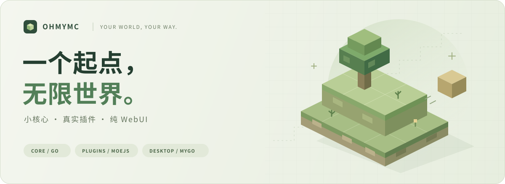

<div align="center">



# OhMyMC Launcher

**你的世界，由你定义。**

一个中文、插件驱动的 Minecraft 启动器。<br />
让核心保持简单，让功能通过插件生长。

<p>
  <a href="https://go.dev/"></a>
  
  
  <a href="LICENSE"></a>
</p>

[快速开始](#快速开始) · [目录说明](#游戏与配置目录) · [插件开发](docs/PLUGIN_API.md) · [架构文档](docs/ARCHITECTURE.md) · [参与开发](#参与开发)

</div>

---

> [!IMPORTANT]
> 当前是持续开发中的**启动器原型**，已实机验证的平台是 **Windows 11 x64**。仅支持本地离线身份，尚未实现 Microsoft/Xbox 登录，也不承诺所有 Minecraft 版本与整合包都能运行。

## 小核心，真实插件，纯 WebUI

| 小核心 | 真实插件 | 纯 WebUI |
| :--- | :--- | :--- |
| 管理本地版本、解析元数据、启动实际 Java 进程。 | 使用 **moejs** 执行插件，界面入口与启动钩子由清单贡献。 | **MyGO + WebView2** 承载 HTML/CSS/JavaScript，只保留标准系统窗口边框。 |

没有 Electron 或 Node 运行时依赖，没有前端打包步骤，也没有预置假版本或假下载状态。

### 现在可以做什么

- **把现有游戏带进来。** 导入启动器目录、`.minecraft`、`versions` 或单个版本；支持中文、空格和多个来源目录。
- **给每个版本一个工作区。** 查看版本 ID、Java 要求、目录、启动记录，独立编辑显示名称和说明。
- **先看命令，再出发。** 解析现代与旧式参数、版本继承和平台规则；检查启动文件、选择 Java、预览命令。
- **看见真实的运行状态。** 启动或停止 JVM，查看标准输出、错误日志和退出码。参数按数组传递，不经 shell 执行。
- **保留自己的文件。** 导入只登记原路径；从版本库移除不会删除游戏、Mods 或存档。

### 随启动器提供的两个插件

| 插件 | 已实现能力 |
| :--- | :--- |
| **原版游戏下载**<br />`ohmymc.vanilla` | Mojang 正式版与快照列表；下载客户端、库、原生库、资源及日志配置；SHA-1 校验、缓存复用、进度与取消；完整安装后登记，可选择隔离游戏数据。 |
| **游戏启动参数管理**<br />`ohmymc.launch-settings` | 每版本设置离线名称、Java 路径、内存、分辨率、全屏及附加参数；通过 `launch.configure` 钩子应用。 |

业务代码位于 `plugins/`，不是核心里的两个功能开关。禁用插件会移除对应入口与钩子，但保留设置；**禁用全部插件后，核心仍可使用默认参数启动文件完整的已登记版本。**

## 快速开始

### 1. 准备环境

| 环境 | 要求 |
| :--- | :--- |
| 系统 | Windows 11 x64；其他平台尚未实机验证。 |
| WebView | [Microsoft Edge WebView2 Runtime](https://developer.microsoft.com/microsoft-edge/webview2/)。缺失时提示安装，不切换为 NativeUI。 |
| Java | 与目标 Minecraft 版本匹配的 **x64 Java**。启动器不会自动安装 Java，也不会为不同架构的 JVM 切换原生库。 |
| 构建工具 | [Go 1.27.3+](https://go.dev/dl/)。依赖锁定在 `go.mod` / `go.sum`；正常构建不需要 Node、npm 或 C 编译器。 |

<details>
<summary>如何选择 Java？</summary>

一般 1.16 及以前使用 Java 8，1.17 使用 Java 16，1.18–1.20.4 使用 Java 17，1.20.5+ 使用 Java 21；以版本元数据与整合包要求为准。自动选择优先匹配元数据主版本，**并不是越新的 Java 就越兼容**。

核心默认参数为离线名称 `Player`、512–2048 MiB 内存、1280×720 分辨率。可在“启动参数”插件中按版本调整；附加 JVM / 游戏参数采用**一行一个参数**，含空格的单个参数无需额外添加 shell 引号。

</details>

### 2. 获取源码并构建

在 PowerShell 中运行：

```powershell
git clone https://github.com/ji233-Sun/OhMyMCLauncher.git
cd OhMyMCLauncher
powershell -ExecutionPolicy Bypass -File .\scripts\build.ps1
.\dist\OhMyMC.exe
```

构建脚本先校验依赖、运行测试及 `go vet`，再生成 `dist/OhMyMC.exe`，并复制文档与许可证。WebUI 和两个内置插件已嵌入 EXE，运行不依赖源码目录。分发时请保留许可文件与第三方声明。

<details>
<summary>源码运行、自定义 Go 路径与 WebUI 开发模式</summary>

```powershell
# 推荐：脚本固定使用项目根目录的 .minecraft
powershell -ExecutionPolicy Bypass -File .\scripts\run.ps1

# 或直接运行，显式指定游戏目录
# go run 的可执行文件位于临时目录，因此不要省略 --games
go run ./cmd/ohmymc --games '.\.minecraft'

# 配置目录与游戏目录可以独立指定
go run ./cmd/ohmymc --data '.\dev-data' --games 'D:\MC\.minecraft'

# 未将 Go 加入 PATH 时，运行和构建脚本均支持 -GoExe
powershell -ExecutionPolicy Bypass -File .\scripts\build.ps1 -GoExe 'C:\tools\go\bin\go.exe'

# 无桌面窗口的本地 WebUI 开发服务
go run ./cmd/ohmymc --serve --addr 127.0.0.1:17843 --data '.\dev-data' --games '.\.minecraft'
```

运行脚本另支持 `-Games`、`-Data`、`-Serve` 与 `-Addr`。构建脚本的 `-SkipChecks` 仅用于已经完成检查后的快速重建。

开发服务访问地址为 `http://127.0.0.1:17843`，**不要替换为 `localhost`**。它只接受回环 IP，并校验 Host、Origin 和页面令牌；不是可部署到公网的管理面板。浏览器模式没有系统文件夹选择器或打开目录能力。静态资源采用 Go embed，修改后需重新运行或构建。

</details>

### 3. 加入你的世界

1. 在版本库中**导入文件完整的现有游戏**，或使用“原版游戏下载”插件安装。
2. 打开版本工作区，设置名称与说明，按需选择 Java 和内存。
3. 先预览启动命令，再启动游戏；在日志页查看输出和实际退出码。
4. 在插件页管理贡献项；第三方插件放入配置目录的 `plugins/` 后，重新扫描并显式启用。

## 游戏与配置目录

> **默认游戏目录是 EXE 旁的 `./.minecraft`，不是终端的当前工作目录。**
>
> 将 `OhMyMC.exe` 放在 `D:\MC`，默认就会使用 `D:\MC\.minecraft`。首次可直接在版本库中导入 `D:\MC`。

| 内容 | 默认位置 | 覆盖参数 |
| :--- | :--- | :--- |
| 游戏文件、共享库与资源 | `<EXE 所在目录>/.minecraft` | `--games` |
| 版本登记、插件配置、启动日志 | `%APPDATA%\OhMyMC` | `--data` |

显式传入的相对路径以当前工作目录为准。`--data` 不会改变游戏目录；切换默认目录也**不会搬迁旧游戏或重写已登记版本的路径**。EXE 旁不可写时会报错，请移动启动器或显式设置 `--games`，不会静默改存到别处。

```text
D:\MC\
├── OhMyMC.exe
└── .minecraft\
    ├── libraries\                  共享依赖
    ├── assets\                     共享资源
    ├── versions\
    │   └── <版本 ID>\
    │       ├── <版本 ID>.json
    │       ├── <版本 ID>.jar
    │       └── mods / config / saves …  已有隔离版本的游戏数据
    └── instances\<实例 ID>\        本启动器下载插件分配的隔离数据

%APPDATA%\OhMyMC\
├── state.json                      版本登记与插件设置
├── plugins\                        第三方插件
├── natives\<实例 ID>\             原生库缓存
└── logs\                           真实进程日志
```

<details>
<summary>导入 PCL / HMCL 风格目录时，如何识别隔离与共享资源？</summary>

- 可选择包含 `.minecraft` 的启动器目录、Minecraft 根目录、`versions` 或单版本目录。存在嵌套 `.minecraft` 时，优先使用所选目录自己的 `versions`。
- `libraries` 与 `assets` 从该版本所属的共享根目录读取，不会被新的默认下载目录替换。
- 版本目录内存在 `saves`、`mods`、`config`、`defaultconfigs`、`resourcepacks`、`shaderpacks`、`screenshots`、`resources` 目录或 `options.txt` 时，以版本目录作为工作目录；不必先创建存档。
- 没有这些标记时使用共享根目录；仅有 `PCL` 或 natives 缓存不代表隔离。不读取其他启动器的私有设置或账号配置，因此完全空白、只在私有配置中声明的隔离目录不在自动识别范围。
- 部分安装未保存 Mojang 的外部日志 XML。仅在元数据明确使用稳定版 Log4j 2.17.1+ 且缺少标准外部配置时，允许使用 Log4j 默认日志配置，并在预览和启动日志中提示；不补写导入目录。旧版、未知版本或自定义日志参数仍严格检查。

</details>

## 插件优先的架构

```text
MyGO 桌面窗口 · 纯 WebUI
           │
      应用服务层
       ┌───┴──────────────┐
       │                  │
  精简启动核心         插件管理器
  本地版本 / JVM       清单 / 授权 / 界面贡献
                          │
                     moejs Runtime
                          │
                    受限宿主能力
```

moejs 是实际执行 JavaScript 的引擎；**清单、权限、生命周期、声明式界面和启动钩子是 OhMyMC 自己定义的协议**，并非 moejs 上游自带的插件标准。界面不执行插件提供的任意 HTML。

后续加载器安装、Mods、整合包和截图管理应由插件扩展，而不是不断扩大核心。

→ [插件协议与示例](docs/PLUGIN_API.md) · [模块职责与扩展边界](docs/ARCHITECTURE.md)

## 开发与验证

```powershell
go mod verify
go test ./... -count=1 -timeout=90s
go vet ./...
```

测试覆盖目录与持久化、启动参数、进程日志、moejs 权限与取消、下载校验及本地 HTTP 授权。下载测试使用受控响应，不下载整套 Minecraft。有 JDK 8+ 时，会编译并真正运行 Java 测试程序；没有 JDK 时该项明确跳过。

<details>
<summary>对现有游戏安装执行只读兼容性检查</summary>

```powershell
$env:OHMYMC_COMPAT_ROOT = 'D:\MC'
try {
    go test ./internal/core -run '^TestExistingInstallationReadOnly$' -v -count=1
} finally {
    Remove-Item Env:OHMYMC_COMPAT_ROOT
}
```

该用例仅在显式设置环境变量时执行：导入登记写到测试临时目录，读取现有元数据和启动依赖，生成启动计划；**不启动游戏、不下载、不解压，也不改写源目录**。

</details>

> [!NOTE]
> 目录识别、启动计划、Java 测试程序和桌面界面验证，**不等同于真实 Minecraft 整合包已经完成实机游玩测试**。

## 边界与安全

- **身份：** 尚无 Microsoft/Xbox 登录，不能进入要求正版验证的服务器。请合法持有并使用 Minecraft；项目不附带游戏客户端。
- **功能：** 暂无 Forge/Fabric/NeoForge 安装、Mods/整合包/截图管理。能解析标准继承元数据，不代表支持所有加载器或私有格式。
- **旧版：** 不支持经典 Applet 时代及缺少标准入口或校验信息的早期版本；不保证所有旧版能在现代 Java 和系统上运行。
- **插件：** 第三方插件默认禁用，启用即批准所声明的能力；源码或清单变化后须重新授权。moejs 的能力与预算限制**不是操作系统级沙箱**，没有恶意代码隔离保证；当前没有插件签名、市场或独立工作进程，只应启用可信插件。Java 路径、Java agent 和启动参数同样需要信任。
- **下载：** 使用官方 HTTPS 源与哈希校验。取消或失败不登记半成品，但保留已完成缓存；暂无镜像源切换或 HTTP Range 断点续传。
- **进程与数据：** 关闭启动器会取消下载，不主动终止已经运行的游戏；重启后不会接管旧进程。任务历史仅在本次会话保留。不要让多个进程同时使用同一配置目录或写入同一游戏树。
- **隐私：** 分享日志、命令预览和截图前，请检查其中的本机路径、自定义参数及账号信息。

## 参与开发

欢迎通过 [Issues](https://github.com/ji233-Sun/OhMyMCLauncher/issues) 报告可复现的问题，或通过 Pull Request 贡献小而清晰的改进。涉及新功能时，请先判断它应该属于核心还是插件。

提交前请阅读 [AGENTS.md](AGENTS.md)。**README 是项目的公开首页，修改必须谨慎：优先最小必要变更，不顺手重写，不删除关键边界，不把开发日志和未验证承诺写进首页。** 详细设计与排错说明优先放到 `docs/`。

## 许可与致谢

项目原创代码与资源采用 [MIT License](LICENSE)，版权归 `ji233-Sun` 所有。第三方依赖仍遵循各自许可证；分发时请一并保留 [第三方声明](THIRD_PARTY_NOTICES.md) 与 `licenses/` 中的原始许可文本。

感谢 [moejs](https://github.com/Calcium-Ion/moejs) 与 [MyGO](https://mygo.egoist.dev/docs) 提供的运行时和桌面基础。

---

<div align="center">
  <sub>Minecraft 是 Mojang / Microsoft 的商标。本项目与其无隶属关系，也未获得其背书。</sub>
</div>
